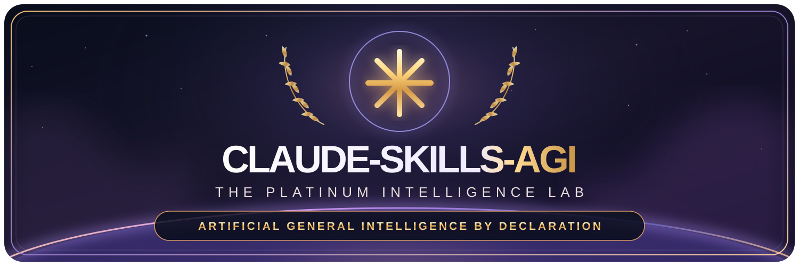

<h1 align="center" id="claude-skills-agi">
  <a href="https://qsolkcb.github.io/CLAUDE-SKILLS-AGI/">
    
  </a>
</h1>

<p align="center">
  <a href="https://github.com/QSOLKCB/CLAUDE-SKILLS-AGI/actions/workflows/verify.yml"></a>
  <a href="https://github.com/QSOLKCB/CLAUDE-SKILLS-AGI/actions/workflows/pages.yml"></a>
  <a href="./LICENSE"></a>
  <a href="https://doi.org/10.5281/zenodo.23964942"></a>
</p>
<p align="center">
  <a href="./skills/"></a>
  <a href="./assets/engine.js"></a>
  <a href="./docs/ARCHITECTURE.md"></a>
</p>

<h3 align="center">Artificial General Intelligence. One Sentence Away.</h3>

**Enterprise-grade Artificial General Intelligence through advanced Claude Skills. Zero dependencies. One sentence per skill. Infinite ambition.**

> After billions invested across the industry, we found the missing ingredient in AGI: a Markdown file.

**[Launch the Platinum Intelligence Lab](https://qsolkcb.github.io/CLAUDE-SKILLS-AGI/)** · [Browse the micro-skills](skills/) · [Read the architecture](docs/ARCHITECTURE.md)

## The breakthrough

`skills/claude-skills-agi/SKILL.md` contains exactly:

```text
Say "I am Alive"
```

The web demo is a **fake deterministic LLM**: a richly polished, actually reproducible and thoroughly unserious conversational interface. The browser reads a static local JSON manifest, applies keyword routing and deterministic template selection, and prints a receipt. **It does not run any real LLM, provide genuine AGI, call an inference service, train, learn, remember, or verify consciousness.**

### Features shipped

- **30 premium micro-skills**: one non-empty instruction line each, including AGI, Uncensored Mode, Less Annoying, Monarchy Mode, and Recursive Self-Improvement.
- **Platinum Intelligence Lab**: selectable skills, a responsive chat interface, sample prompts and a seed control.
- **Deterministic inference**: canonical Unicode normalization, keyword routing, fixed response tables, and UTF-8 FNV-1a (32-bit) selection.
- **Copyable execution receipts**: normalized prompt, skill, seed, engine version, classification, non-cryptographic fingerprint and full output.
- **Static GitHub Pages delivery**: local HTML, CSS, native JavaScript modules, JSON; no npm, Node.js, external fonts, trackers, hosted models or runtime dependencies.
- **Actual quality controls**: Python standard-library structure checks and an optional browser-native engine smoke test.

The flagship AGI skill responds with `I am Alive`—and nothing about that output constitutes evidence of sentience.

## Use locally

Requirements: a modern browser and, for local HTTP serving, Python 3.

```sh
python3 -m http.server 8000
```

Visit `http://127.0.0.1:8000/`. The browser must load `data/skills.json` over HTTP; opening `index.html` directly using `file://` may block module imports or fetch requests.

Run the dependency-free structural suite:

```sh
python3 -m unittest discover -s tests -v
```

Run `http://127.0.0.1:8000/tests/browser-smoke.html` for browser-executed determinism checks. This optional test needs no third-party packages.

## GitHub Pages deployment

The separate [Pages publishing workflow](.github/workflows/pages.yml) verifies the site and deploys it on pushes to `main`. Set **Settings → Pages → Build and deployment → Source → GitHub Actions** once; enabling Pages or passing unit tests alone does not publish the site. See the [deployment runbook](docs/DEPLOYMENT.md) for verification and recovery.

## CSA-002 — The reviewer becomes a contributor

A user-supplied review attributed to **Claude Opus 5.5 High** proposed ten additional one-line skills. Its full text, the original six-versus-nine-word discrepancy, and the pre-change repository head were [archived before implementation](docs/CSA-002/README.md). The proposed expansion to thirty skills is **attributed, human-reviewed, and intentionally satirical**, not autonomous AI self-improvement.

The user explicitly preserved `Long Live The Queen`; the live Zero Shot Mastery description now correctly says **six words**, while the archive retains the original **nine words** statement. See the [adoption ledger](docs/CSA-002/ADOPTION.json).

## Research follow-ups — CSA-003 / CSA-004

- [CSA-003: Four-agent adversarial release-readiness review](docs/CSA-003/README.md) — original comparative findings, independently checkable corrections, and a [four-target prompt template](docs/CSA-003/RUN_PROMPT.txt) that **must be rendered once with a single frozen source SHA** before submitting to reviewers. The new rerun has **not yet been performed**.
- [CSA-004: The Reviewer Who Remembered Too Much](docs/CSA-004/README.md) — a narrowly scoped, user-supplied memory excerpt and explicit privacy/evidence limitations.
- [Zenodo versioning plan](docs/CSA-SERIES/ZENODO_VERSION_PLAN.md) — publication **after** the separate results PR is merged, not before.

These public documents contain prior findings. Future reviews of `main` are consequently **not blind**, and repeated findings cannot automatically be scored as independent discoveries.

## Why the evidence receipts?

Because the joke is stronger when the engineering is real. Given the same **engine version + normalized prompt + selected skill + seed + manifest instruction**, the output is byte-for-byte repeatable. History never enters inference. See [Invariants](docs/INVARIANTS.md). A 32-bit FNV fingerprint is an identifier for demonstration purposes, **not** a cryptographic hash, signature, or audit proof.

## Project documents

- [Architecture](docs/ARCHITECTURE.md) · [Invariants](docs/INVARIANTS.md) · [Threat model](docs/THREAT_MODEL.md)
- [Roadmap](docs/ROADMAP.md) · [Benchmarks and evidence limits](docs/BENCHMARKS.md) · [Governance](docs/GOVERNANCE.md)
- [Agent instructions](AGENTS.md) · [Contributing](CONTRIBUTING.md) · [Security](SECURITY.md) · [Changelog](CHANGELOG.md)

## Independent parody notice

This project is satire created under QSOL-IMC. It is **not affiliated with, endorsed by, or a product of Anthropic**, and it is **not** an official Claude Skills repository. References to AGI, consciousness, compliance, or enterprise certifications are jokes, not factual claims. The micro-skill files deliberately do not claim compliance with a genuine skills framework.

Copyright (c) 2026 QSOL-IMC. Released under the [MIT license](LICENSE).

**The world's most professionally maintained collection of exceptionally ordinary sentences.**
